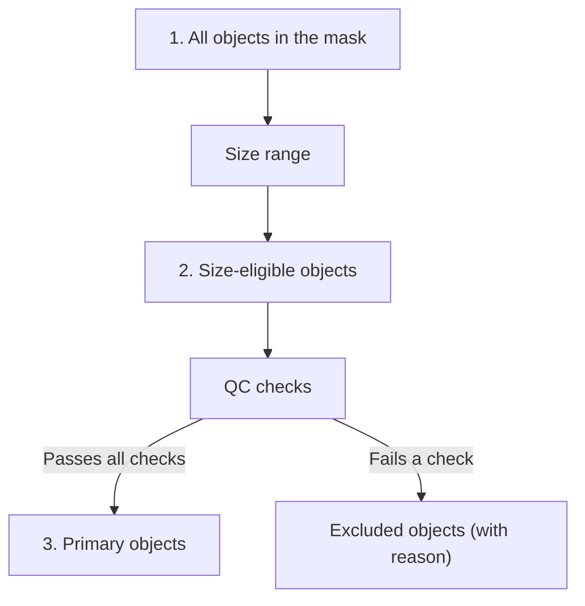

# Quality Control Pipeline

ExQt sorts the objects of a run into three groups:

---

## The Three Groups

### 1. All Objects (`<folder>_Output_Batch_3d.csv`)
Every connected component of the mask inside the ROI that is larger than the noise filter.

### 2. Size-Eligible Objects
Objects within the chosen size range (Min size – Max size).

### 3. Primary Objects (`<run>_Primary_Condensates.csv`)
The objects used for the summary statistics and plots. An object is primary if it is size-eligible and:

- does not touch the edge of the image/stack or the alignment padding (`touches_image_edge`); with the optional Z-edge setting, objects cut only by the first/last Z slice are kept (`touches_z_edge_only`, `z_edge_allowed`);
- is not cut by the ROI boundary (`touches_roi_edge`);
- does not come from a stack whose alignment status is `REVIEW` (`alignment_status`; `REVIEW_OUTSIDE_ROI`, where every weak step lies outside the ROI Z range, is allowed);
- with Radial FA Profiling: passes the Z-topology check, has all layer FA valid and enough core voxels (`mode_a_primary_include`). With **Settings → QC: Keep objects too small for radial layers** (off by default) an object whose only problems are the radial layers (empty layer, too few core voxels, invalid shell/middle FA, layer coverage) stays primary for size, $K_{\text{part}}$ and object FA; its radial values are NaN, `radial_profile_valid = False`, `radial_profile_reason` names the layer problem and the class is `Profile-Unavailable` (or `Punctate / Small Cluster`). Without the option these objects are excluded, which biases the primary objects towards large ones. Recorded as `small_objects_kept` and in the QC policy fingerprint.

Size-eligible objects that fail a check are saved in `<run>_QC_Excluded.csv` with the reason.

---

## Implementation

The flags are computed per object in `Batch.process_condensates` and combined in `postprocessing._prepare_reporting_frames`:

`primary_qc_valid = size_eligible & object_fa_ok & mode_a_primary_include & alignment_ok & not_truncated`

`object_fa_ok` equals `fa_complete` (complete radial profile), or only a valid object FA for objects kept by the small-object option. (`fa_complete` and `mode_a_primary_include` are always `True` when Radial FA Profiling is off.) The Radial FA Profiling plots always use objects with a complete radial profile.

---

## Warnings (nothing is removed)

ExQt writes a warning to the log (`RED FLAG: …`), to `*_metadata.json → red_flags` and to the Excel Summary when:

- one nucleus contains more than 1000 objects (`objects_per_nucleus`);
- the median object size in a file is below 50 voxels (pixels in 2D) (`median_size_below_min`);
- more than 1 % of the object voxels of a file are at the detector ceiling (`saturated_signal`).

The first two can indicate over-segmentation or noise; check the mask, `min_voxels` and the expansion factor. Saturated voxels have an unknown true intensity, so $K_{\text{part}}$ is underestimated. The ceiling is the bit-depth limit the image reaches (e.g. 4095 for 12-bit data stored as 16-bit), otherwise the maximum of the data type; rescaled outputs such as deconvolution often reach it too, so measure $K_{\text{part}}$ on the raw image. Per object: `saturated_voxels`, `saturation_level_adu`.

---

## Known Limitation: Size Selection

With Radial FA Profiling the primary set requires a valid core FA (`min_core_voxels`, default 20). The core holds only about 4 % of an object's volume, so in practice objects need roughly 500 voxels or more. Statistics of the primary set describe these larger objects, not all objects. The Excel Summary row `Primary selection bias` reports the number and median size of primary and excluded objects for each run.
